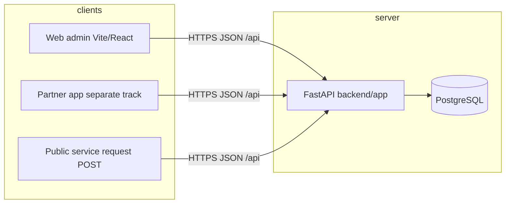

# Technical Requirements Document (TRD)

**Companion:** `01-PRD.md`  
**Stack reference:** `migration-db/ACTIVE-STACK.md`  
**Updated:** 25 October 2026  

---

## 1. System context



| Layer | Location | Responsibility |
|-------|----------|----------------|
| Admin UI | `web/` | Routes, forms, imports UI, module access gates |
| API | `backend/app/` | Validation, business rules, transactions |
| Database | PostgreSQL via SQLAlchemy + Alembic | `backend/alembic/versions/` |
| Media | `GET /api/media/proxy` | Hotlinked product images |

**Local dev:** `VITE_BACKEND_URL` → API origin (no `/api` suffix); API `uvicorn app.main:app` port **8001** — see root **`README.md`** § Local development.

---

## 2. API conventions

**Envelope (all JSON routes):**

```json
{ "success": true, "data": { }, "error": null }
```

**Auth:**

- Admin: `POST /api/auth/admin/login` → bearer token in `Authorization` header.
- Team roles: `admin`, `store_manager`, `staff` on `users` table.
- Protected routes use `backend/app/deps/auth.py`; operational and catalog routes expect token where configured.

**Module access (admin product feature):**

- Stored on user: `module_access` JSON + role defaults in `backend/app/access_modules.py`.
- Levels: `hidden` | `read` | `write` per module id (`product-management`, `rfqs`, …).
- Web mirrors with `web/src/access/*` and `AccessGate` on routes.

**CORS:** Explicit origin allow-list; no `*` with credentials (`backend/app/main.py`).

**Health:** `GET /api/health` → `{ "status": "ok" }`.

**Historical reference:** Mongo-era route inventory in `docs/BACKEND_INVENTORY.md` — use for IDs only; **live code is Postgres**.

---

## 3. Data architecture principles

| Principle | Implementation |
|-----------|----------------|
| Stable ids | UUID strings on entities; APIs expose `id`, not internal row ids |
| Taxonomy by FK | Categories, brands, types, subcategories linked by id in Postgres |
| SKU = sellable row | Unique `product_code`; stock, pricing, RFQ lines reference code |
| Product family | Logical grouping (pipes/fittings v1); images on family — `migration-db/CATALOG-DESIGN-RULES.md` |
| Rewards | Append-only `reward_ledger`; balance = sum(earned) − sum(redeemed) — redemption path deferred |
| RFQ lifecycle | `pending` → `approved` / `rejected` → `dispatched` (on dispatch) |
| One dispatch per RFQ | Unique constraint on `source_rfq_id` |
| Transactions | Purchase create, RFQ approve, dispatch create wrapped in DB transactions |

**Soft delete:** `deleted_at` on several tables — queries must filter active rows in services.

---

## 4. Core table groups (PostgreSQL)

Logical groups (see `backend/app/models/__init__.py` for full schema):

| Group | Tables (representative) | SOW modules |
|-------|-------------------------|-------------|
| Auth | `users`, `admin_tokens`, `partner_tokens`, `money_config` | Team, register |
| Partners | `partners` (+ KYC JSON/history fields) | M8, M9 |
| Taxonomy | `categories`, `subcategories`, `brands`, `product_types` | M1–M3 |
| Catalog | `product_families`, `catalog` (SKUs), `pricing`, `pricing_history` | M4 |
| Groups | `product_groups`, `product_group_items` | M5 |
| Warehouse | `racks`, `rack_slots` | M6 |
| Purchasing | `purchases`, `purchase_lines` | M7 |
| Quotes | `rfqs`, `rfq_lines`, `rfq_history` events | M10 |
| Fulfillment | `dispatches`, `dispatch_lines` | M11 |
| Rewards | `reward_ledger` | M10 |
| Service | `service_requests` (+ embedded history) | M15 |

**Data migration note:** Bulk copy of historical operational rows from old Mongo may still be pending (`migration-db/DB-STATUS.md` row 14) — does not block greenfield Postgres use.

---

## 5. Admin UI architecture

**Shell:** `AdminShell` — sidebar/drawer, session from `AdminSessionProvider`.

**Primary catalog surface:** `/product-management` (`ProductManagementPage`) — list, taxonomy modals, import hub, export session.

**Legacy routes:** `/catalog`, `/categories`, … redirect via `CatalogLegacyRedirect` to hub (do not reintroduce duplicate screens without updating this guide).

**Route map:** `web/map/INDEX.md` (regenerate line refs with `web/map/tools/generate-page-maps.mjs` after large edits).

**Spreadsheet imports:**

- Category-specific: pipes & fittings v1 (`backend/app/services/pipes_fittings_import.py`).
- Legacy/master columns: `migration/SHEET-FORMAT.md`.
- Index of sheets: `migration/SHEET-IMPORTS-INDEX.md`.

---

## 6. Module technical specs (summary)

### M1–M3 Taxonomy

| Item | Detail |
|------|--------|
| Routers | `taxonomy.py`, `subcategories.py` |
| Rules | Unique names; rename cascades to dependent display fields where implemented |
| Web | Hub panels + legacy redirects |

### M4 Catalog / product

| Item | Detail |
|------|--------|
| Router | `catalog.py` |
| Design lock | `migration-db/CATALOG-DESIGN-RULES.md` |
| Import pipeline | Validate sheet → families + SKUs; optional image sidecar |
| Read API | Flat SKU JSON with joined family fields for clients |
| QR | Client-side render from `product_code` |

### M5 Product groups

| Item | Detail |
|------|--------|
| Router | `product_groups.py` |
| Model | Many-to-many via join table |

### M6 Racks

| Item | Detail |
|------|--------|
| Router | `racks.py` |
| Slots | One row per slot; assign via `PUT .../assign` |

### M7 Purchases

| Item | Detail |
|------|--------|
| Router | `purchases_rfq.py` (purchases section) |
| TXN | Stock + purchase lines in one transaction |
| Partner id | Required on purchase in Postgres (schema improvement vs Mongo) |

### M8–M9 Partners

| Item | Detail |
|------|--------|
| Router | `partners_team.py` |
| KYC | Status fields + `kyc_history` |
| Rewards | `GET .../rewards` aggregates ledger |

### M10 RFQ

| Item | Detail |
|------|--------|
| Router | `purchases_rfq.py` |
| Approve | TXN: status + `reward_ledger` insert |
| Lines | By `product_code`; prices from catalog/pricing at create time |
| History | Append events on changes |

### M11 Dispatch + M12 Inventory

| Item | Detail |
|------|--------|
| Router | `dispatch_inventory.py` |
| Dispatch TXN | Stock decrement + dispatch rows + RFQ status |
| Inventory | Aggregates stock, movements, low stock, valuation endpoints |

### M13 Team

| Item | Detail |
|------|--------|
| Router | `auth.py`, `partners_team.py` (`/team/users`) |
| Module access | `user_module_access` migration; API tests `test_module_access_api.py` |

### M14 Dashboard

| Item | Detail |
|------|--------|
| Router | `dashboard.py` |
| Scope | Snapshot counts — not full report engine |

### M15 Service requests

| Item | Detail |
|------|--------|
| Router | `service_requests.py` |
| Public create | `POST /api/service-requests` (unauthenticated or as documented) |
| Contract | `docs/SERVICE-REQUESTS-API.md` |

---

## 7. Partner app API (separate track)

| Item | Detail |
|------|--------|
| Router | `partner_app.py` |
| Auth | Firebase validation `firebase_auth.py` |
| Doc | `docs/PARTNER_APP_API.md` |
| PRD | Not counted in admin SOW completion |

Do not remove or break these routes when changing admin; coordinate versioned changes.

---

## 8. Key business rules (implementations)

| Rule | Where enforced |
|------|----------------|
| Selling price from MRP + discount % if selling not sent | Catalog service |
| Stock += purchase qty | Purchase transaction |
| Stock -= dispatch qty | Dispatch transaction |
| Reward on approve once per RFQ | Approve transaction + ledger type `earned` |
| RFQ not editable after dispatched | Service validation |
| Secured catalog delete / wipe | Passcode confirm in UI + API |

---

## 9. Engineering hardening (recommended, not all SOW)

Labelled **future** unless already done:

| Topic | Recommendation |
|-------|----------------|
| API RBAC | Align every mutating route with `module_access` + role |
| Pagination | Consistent `limit/offset` on large lists |
| Idempotency | Dispatch/purchase duplicate-submit keys |
| Audit log | Generic admin action log (beyond RFQ/KYC history) |
| Redemption | Ledger `redeemed` type + partner spend flow |
| Observability | Structured logs, metrics on import jobs |

---

## 10. Testing and verification

| Area | Location |
|------|----------|
| API tests | `backend/tests/` |
| Postgres schema | `test_postgres_schema.py` |
| Partner app | `test_partner_app.py` |
| Pipes import | `test_pipes_fittings_validation.py` |
| Owner UAT | `migration/bug_fix/OWNER-SIGNOFF.md` |

**Step 2 (next doc):** `03-alignment.md` will walk PRD/TRD vs `web/` + `backend/` and list concrete gaps.

---

## 11. Related documents

| Doc | Use |
|-----|-----|
| `01-PRD.md` | What and why |
| `00-index.md` | Roadmap |
| `docs/SOW-PROGRESS.md` | Simple % handover |
| `migration-db/DB-STATUS.md` | Migration row status |
| `docs/migration/STATUS.md` | Web port row status |
